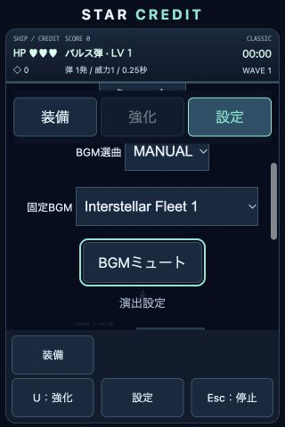

# 軽量BGM実装報告

## 実装

既存のWeb Audio管理・マスター/BGM/SEバス・SE合成・設定保存を再利用しました。依存パッケージ・フレームワークは追加していません。ゲームの敵・攻撃・ドロップ・育成・MAGNET・モード計算は変更していません。

CC0を確認した候補4曲のループ版を取得し、ステレオ・44.1kHz AACへ変換しました。[作者・配布元・ライセンス・取得日](audio-licenses.md)を記録しています。音楽の場面割当は初期選定です。タイトルのBrute Forceが落ち着いた宇宙感という方向性に適するか、ボス曲の短いループに疲労感がないかは実聴の確認が残ります。

AUTOはタイトル・通常戦闘・ボスを選曲し、エンドレスPhase 6以降（第2周期）では専用曲を選びます。ボスが優先し、撃破後は通常曲または後半専用曲へ復帰します。後半の開始基準はsrc/audio/bgmCatalog.jsのENDLESS_BGM_PHASEで調整できます。結果画面はファイルBGMを停止し、既存の短い結果ジングルを使用します。

MANUALは4曲から固定選曲、OFFはBGM停止です。BGM専用ミュートも追加しました。BGM/SE独立音量と全体ミュートを維持し、選曲とミュートを既存star-credit-audio-v1へ追加保存します。旧設定はAUTO・通常曲・BGMミュートOFFとして読み込めます。他の保存キーは変更していません。

最初のタップ・キー操作からAudioContextを有効化します。起動時の全曲読み込みはせず、現在必要な曲だけfetch・非同期decodeAudioDataします。音声読み込みを戦闘更新からawaitしません。切替は0.18秒フェード、ポーズ・背景移行では即時停止し、同じ曲は途中から再開します。visibilitychange・pagehideに対応し、背景ではContextも中断します。復帰後は既存の明示的な再開操作で有効化します。

同じ選曲要求で再起動しません。世代番号とAbortControllerで古い読み込みを無効化し、切替中の旧音源は最大1つに制限します。キャッシュは現在のデコード済み曲1つだけです。HTTP・デコード失敗・15秒タイムアウトでは既存合成BGMへフォールバックし、その曲の再取得は当該セッション中に繰り返しません。エンドレスのフォールバックは既存通常戦闘曲です。

## 容量

KB/MBは10進。元音源は一時領域に保管し、配布物にはM4Aだけを含めます。

|場面|取得物の実サイズ|配布M4A|設定ビットレート|長さ|
|---|---:|---:|---:|---:|
|タイトル|WAV 39,257,168 bytes|1,199,333 bytes（1.199MB）|64kbps|148.36秒|
|通常戦闘|MP3 1,976,181 bytes|829,882 bytes（830KB）|80kbps|約82秒|
|ボス|WAV 4,368,690 bytes|299,960 bytes（300KB）|96kbps|24.76秒|
|エンドレス後半|ZIP 66,170,656 bytes / 採用WAV 31,264,198 bytes|890,939 bytes（891KB）|80kbps|88.62秒|

BGM合計 **3,220,114 bytes（3.220MB）**。SE・結果ジングル・フォールバックは合成のため追加音声ファイル0 bytes、配布音声全体も同じ3.220MBです。ボスは短い原曲なので500KBより小さく、容量合わせの水増しはしていません。実効ビットレートはAACエンコーダの処理により指定値と多少異なります。

圧縮ファイルサイズと再生時メモリは別です。最長曲のステレオFloat32デコードは約52〜57MB（Contextの44.1/48kHzに依存）。切替中は旧曲と新曲が一時的に共存します。低メモリiPhoneでの実使用メモリ・デコード負荷・描画への影響は未測定であり、性能保証とは扱いません。

## 検証

全自動テスト **103件成功、失敗0件、スキップ0件**。既存92件を維持し、BGM回帰10件と実ゲームの場面連動1件を追加しました。旧設定テストは追加フィールドの期待値を更新しました。PWAサーバーテストにM4Aのaudio/mp4を追加しています。

ユーザー操作前の未取得、ループ、再生停止、フェード、通常→ボス→通常、AUTO/MANUAL/OFF、保存復元、二重再生防止、遅延読み込みの無効化、HTTP/デコード失敗、タイムアウト、Context中断復帰、全モードと既存ゲーム機能を検証しました。公開用ビルドも成功し、4曲をdist/src/assets/audioに含めています。

ブラウザでは4曲すべてのAACデコード・再生開始状態、MANUAL選曲とOFF停止、ゲーム側設定項目を確認しました。コンソールエラー・警告0件。320×480模擬画面で固定BGM欄は幅205px・高さ44px、横スクロールなし、下部操作ボタンが表示されています。検証はメモリ保存ページで行い、利用者の実セーブを変更していません。聴感確認と実iOS確認の代用にはなりません。

## 変更ファイル

- src/audio/bgmCatalog.js、fileBgm.js（追加）、audioManager.js
- src/assets/audio/title.m4a、battle.m4a、boss.m4a、endless.m4a（追加）
- src/main.js、src/style.css、server.js
- tests/bgm.test.js（追加）、audio.test.js、game.test.js、pwa.test.js
- docs/bgm-check.html、audio-licenses.md、bgm-report.md、screenshots/bgm-settings.jpg、screenshots/bgm-settings-320x480.jpg（追加）
- README.md

manifest・PWAメタタグ・アイコン・依存構成は維持しています。実行中の旧開発サーバーは停止していません。server.jsの新しいM4A Content-Typeは次回サーバー起動から反映されます。Web Audioのfetch/decodeは旧サーバーのapplication/octet-streamでも今回のブラウザでは成功しました。HTTPS公開先ではaudio/mp4を設定してください。外部公開は行っていません。

## 未確認事項と検証手順

実iPhoneのSafari/PWA、画面ロック・アプリ切替・着信や他アプリ音声との中断、低メモリ時の安定性、実聴での音質・ループ継ぎ目・場面適性・長時間疲労感、低速回線での実測、HTTPS公開先の配信は未確認です。

1. HTTPS公開先をiPhone Safariとホーム画面PWAで起動する。タップ前は鳴らず、タップ後に必要曲だけ取得されることを確認する。
2. タイトル・通常戦闘・ボス・エンドレスPhase 6以降をプレイし、選曲と短いフェード、ボス撃破後の復帰、ゲームオーバー時の停止を確認する。MANUALが場面をまたいで固定され、OFFでもSEが鳴ることを確認する。
3. ポーズ・設定・画面ロック・アプリ切替・着信を試す。復帰して明示的に再開し、二重再生・誤発射がないことを確認する。選曲・音量・ミュートを変更して再起動し、復元を確認する。
4. /docs/bgm-check.htmlで各曲を2周以上聴き、継ぎ目の無音・クリック・音量差、圧縮ノイズを確認する。通常・後半曲は20分以上聴いて疲労感を確認する。タイトル曲の落ち着きも評価し、必要なら確認済み候補内の割当やビットレートを調整する。
5. 低速回線・音源404・オフラインで、読み込み中も移動と描画が続き、失敗後に合成BGMへ戻ることを確認する。実機のメモリ・フレーム時間・発熱を測定する。
