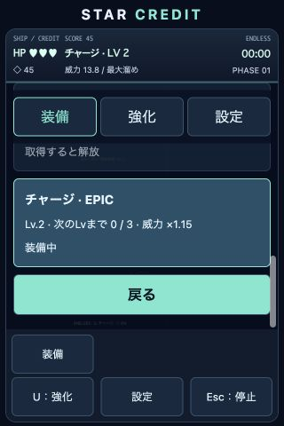

# 装備・強化・設定の統合報告

## 調査と変更

package.jsonは外部依存なし。JavaScript ES Modules、Canvas 2D、HTML/CSS、server.js、Node標準テストランナー、バージョン付きlocalStorageという指定どおりの構成でした。新しいフレームワーク・Capacitorは導入していません。

従来は主武器と追加攻撃の2枠保存、run.weapon/run.extra、専用コレクション画面・図鑑の武器タブ・ショップの装備導線が重複していました。今回、保存値 inventory.data.equipped を単一の攻撃方法にし、既存戦闘処理用のrun.weapon/run.extraは読み取り専用の派生値に変更しました。カード・Space・Q・ゲームパッドからの選択は同じ処理を使います。選択した攻撃方法だけが新しい弾を発射し、切替前に発射した弾は維持します。

「装備」は全6攻撃の名前、レアリティ、レベル、進捗、装備中、未取得ロックを表示するカードボタンです。「強化」は既存機体強化とMAGNET、「設定」は音量・演出・操作設定に整理しました。独立した武器メニュー・図鑑武器タブを削除しました。育成は重複ドロップのみで、装備画面でコインは使いません。メニュー間を移動しても戦闘は停止し、戻ると元の画面へ復帰します。溜め中にメニューを開くと溜めを解除します。

コイン100%・武器抽選5%の独立ドロップ、二重付与防止、MAGNETの価格・範囲・速度、成長定義、全モードの敵と攻撃計算は維持しました。今回の指定に従い、従来の2攻撃同時装備・OFF選択は単一装備に置き換えています。キーボード・ゲームパッドのボタン割当、タッチ相対ドラッグは維持しました。

## 保存互換性

新キーはstar-credit-weapons-v3。正常なv3を優先し、未保存・不正なら旧v2を読みます。旧v2の所持済み追加攻撃が有効ならその攻撃を、OFF・未所持なら主武器を採用します。レベルと進捗を保持し、不正値は安全な範囲に補正します。旧v1記録から全6種類を解放する互換処理も維持しました。旧キーは削除・上書きしません。新規データはパルス弾を初期装備とし、以降は全モードで保存済み装備を使用します。

## 自動確認

全92件成功、失敗0件、スキップ0件。既存81件を維持し、単一装備という指定変更に関係する期待値を更新、11件を追加しました。初回取得・重複育成・所持切替・未所持拒否・保存復元・v2/v1互換・不正保存・MAGNET・HUD一致・PC/スマホのメニュー入力・全攻撃の単独発射を確認しています。クラシック、チャレンジ、エンドレスの実更新、旧版との1200フレーム比較、移動とチャージの同時タッチ、既存PWA回帰4件も成功しました。

公開用ビルド tools/prepare-publication.mjs が成功しました。manifest、アイコン、PWAメタタグ、server.js、package.jsonは今回変更していません。index.htmlの変更は下部の「装備」ラベルです。外部公開は行っていません。

## ブラウザ確認

保存をメモリに限定した検証ページでチャージを3個取得し、45コイン・Lv.2、未取得ロック、選択カードとHUDの一致、Enterによる設定への移動を確認しました。コンソールエラー・警告は0件。320×480の模擬画面ではカード100px、主要ボタン44pxを確保し、一覧をスクロールしても戦闘画面と下部ボタンを表示できました。この検証ページは小型画面向けCSSとタッチUIを強制するため、実Safariの検証とは区別しています。

## 今回変更したファイル

- src/main.js、src/style.css、index.html
- src/features/equipment.js（共通選択）、equipmentUI.js（装備カード）、weaponInventory.js（単一保存・移行）
- src/features/collectionUI.js、extraWeapons.js、controls.js
- src/rendering/hud.js、challenge.js
- tests/equipment.test.js、game.test.js、loot.test.js、regression.test.js
- docs/mobile-check.html、equipment-check.html、screenshots/equipment-unified.jpg、screenshots/equipment-320x480.jpg
- README.md、docs/equipment-report.md

過去フェーズ・PWA・ドロップ実装の作業中ファイルはそのまま保持しています。

## 未確認と検証手順

実iPhoneのSafari／ホーム画面起動、実際のセーフエリア・ジェスチャー抑制、物理ゲームパッド、既存利用者の実保存データ、長時間の育成バランスは未確認です。

1. HTTPS公開先を小型iPhoneで開き、ホーム画面からも起動する。縦画面で装備・強化・設定と戦闘画面が収まり、画面端やホームインジケータにボタンが重ならないことを確認する。
2. 装備一覧をスクロールし、所持カードをタップする。ロックカードが選べず、選択名・LvとHUDが一致することを確認する。設定・強化を経由して戻り、戦闘が正しく再開することを確認する。
3. チャージを選び、別の指で移動と溜めを同時操作する。各指を異なる順序で離す、キャンセルする、設定を開く、アプリを背景にする操作で誤発射や移動継続がないことを確認する。
4. 装備を選択して閉じ、同じ起動方法で再起動する。所有・Lv・進捗・装備が復元されることを確認する。旧v2データはバックアップした別環境で移行し、追加攻撃／OFFの両方を確認する。
5. PCのキーボードと物理パッドで移動、Space相当、Q相当、チャージ、強化、ポーズを試す。全モードで選択した1攻撃が発射され、MAGNETがコインと攻撃方法を回収することを確認する。
