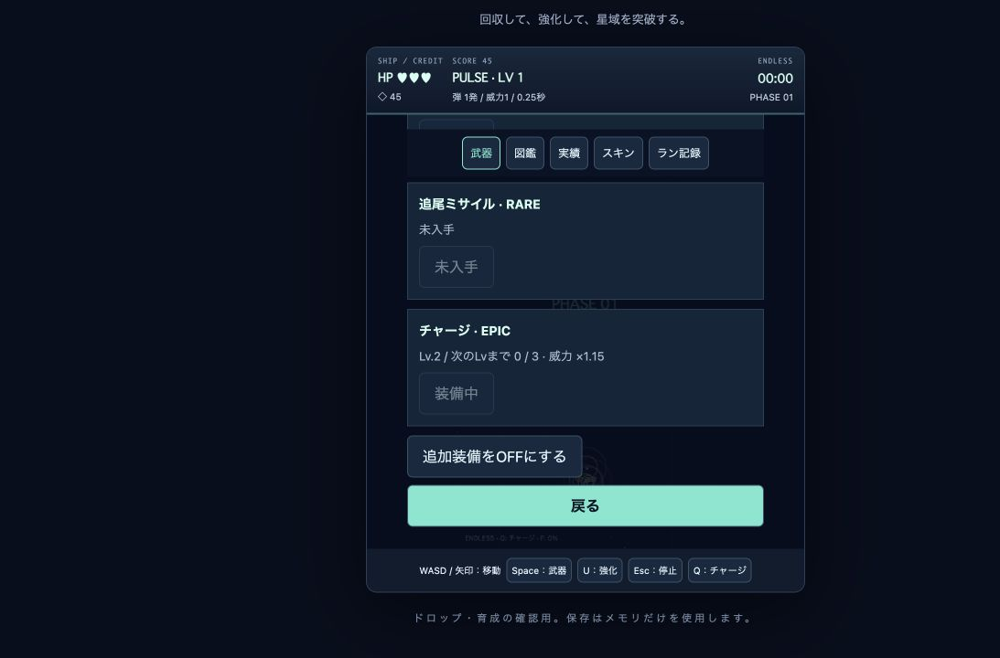

# ドロップ・武器育成・MAGNET実装報告

## 実装前に確認した競合と対応

| 既存処理 | 新仕様との関係と採用した対応 |
| --- | --- |
| `model.defeat` はコインを必ず出し、`enemy.dead` で二重撃破を防ぐ | コイン処理の後に独立した武器抽選。両方を同じガード内で生成 |
| `model.collect` は回収でだけ残高と累計回収を増やす | 武器は所有・育成へ分岐し、残高と累計回収には加算しない。`item.dead` で二重回収を防ぐ |
| 追加装備は全種類を自由にQ切替できる | 所有武器のみへ制限。旧ユーザーの使用可能装備は移行で保護、新規データは弾・ビーム・拡散弾を初期配布 |
| 弾／ビームと追加装備を併用できる | 主武器1枠＋追加装備1枠を維持。育成倍率は威力だけに適用 |
| ショップ強化5種はランごとに初期化 | 既存の費用・性能を維持してMAGNETを追加。MAGNETもランごとに初期化。武器育成は永続 |
| 3モードで吸引の半径40・速度360・落下90が別実装 | 共通の `moveItems` に統合。未強化の挙動を維持し、範囲と速度を設定データ化 |
| クリア時に残アイテムを自動回収する | コインの従来仕様を維持し、武器も同じタイミングで一度だけ回収。結果画面にも入手通知を掲載 |
| v1基本保存と各機能の別保存キー | 新規 `star-credit-weapons-v2` へ移行。旧キーを変更せず、既存全6武器をLv.1登録。移行後のv2を優先し、育成・装備を復元 |

武器の初期配布、旧武器の移行時解放、Lv上限5、重複必要数2/3/4/5、Lv倍率1/1.15/1.35/1.6/2、MAGNET費用50/100/200と範囲40/80/120/180は、未指定部分に採用した初期設定。すべてデータ定義で調整できる。最大Lv後の重複処理は `maxDuplicate:'ignore'`、武器を消費してコイン・育成進捗を追加しない。

敵別の率／抽選候補は `WEAPON_DROPS.enemyRates`／`enemyTables`。未指定なら全敵・両ボスとも基本5%。ドロップ候補の重みはCOMMON各3、RARE各2、EPIC1。レアリティ表示も定義に置いた。装備を選択するまで追加装備の保存値 `null` はモードの初期装備を意味し、選択後は永続保存した装備を使用する。

## 今回の変更ファイル

- `src/features/weaponCatalog.js`：武器定義、敵別抽選、育成倍率（新規）。
- `src/features/weaponInventory.js`：所有・育成・装備・v1からの移行・v2保存復元（新規）。
- `src/features/items.js`：コインと武器の共通吸引・接触回収（新規）。
- `src/model.js`：独立した武器ドロップ／回収、基本武器の育成倍率。
- `src/config.js`：MAGNET範囲・費用・吸引速度。
- `src/features/extraWeapons.js`：所有武器だけのQ循環と発射、育成倍率、装備保存。
- `src/features/challenge.js`：チャレンジ／エンドレス共通回収と通知コールバック。
- `src/main.js`：インベントリ接続、装備適用、コレクション入口、入手・育成通知、クリア時回収。
- `src/features/collectionUI.js`：武器名・レアリティ・Lv・進捗・装備ボタン。
- `src/features/progression.js`：新MAGNETのMAXで既存の「武器最大強化」実績を誤付与しない。
- `src/rendering/sprites.js` / `renderer.js`：武器アイテムのピクセル箱と識別文字。
- `src/rendering/particles.js`：粒子OFFでも表示する3秒の入手・育成通知。
- `src/style.css`：武器コレクションのボタンを44px以上にする規則のみ追加。
- `tests/loot.test.js`：新規単体・UIテスト11件。
- `tests/game.test.js`：本番の3モード統合テスト3件追加、新しいimportをハーネスへ注入。既存チャージ操作テストでは所有を明示して従来の操作検証を維持。
- `tests/regression.test.js`：新しいimportを注入。武器抽選を無効・Lv.1で固定し、新インベントリだけを比較対象外にして従来戦闘状態の比較を維持。
- `docs/mobile-check.html`：既存チャージ確認用に武器所有を明示。
- `docs/loot-check.html` / `docs/screenshots/weapon-collection.jpg`：メモリ保存だけのブラウザ確認とスクリーンショット（新規）。
- `README.md` / `docs/loot-report.md`：操作・設定・移行・検証の説明。

PWAのmanifest・アイコン・HTMLメタタグ・開発サーバー・公開スクリプトは、この作業では変更していない。先行フェーズの未コミット変更は維持した。

## 検証結果

- Node `--test`：既存67件＋追加14件、計81件成功。失敗・スキップ0。
- 抽選の5%境界、敵／ボス別率と候補・重み、コイン100%、二重撃破／回収、武器回収時のコイン非加算。
- 初回入手、各Lvの重複数、最大Lv、未入手装備拒否、所有分だけの循環、全6武器の育成威力と既存強化との掛け合わせ。
- v1移行の再実行防止・旧保存内容の保持、v2再起動復元、不正値・破損・保存禁止。
- MAGNETの費用・段階・不足・上限・リトライ初期化、両アイテムの吸引、ドロップ率不変。
- 本番の全3モードで撃破→コイン＋チャージ→吸引→初回通知→重複Lv.2→装備→再起動復元。
- 装備切替で既存の弾を消さずチャージを解除。両ステージのクリア自動回収で武器を一度だけ登録。
- 新規インベントリを除く旧版との1200フレーム戦闘比較が一致（ドロップ無効・Lv.1条件）。
- ブラウザ：実際のES moduleを読み込むメモリ保存の確認ページで、コイン45、MAGNETの残高不足表示、未入手武器の無効化、チャージLv.2／EPIC／次Lvまで0/3、マウスによる装備、Enterによるショップへの復帰を確認。consoleのerror／warnは0件。
- `git diff --check` 成功。

## 未確認事項と手順

- 実iPhone／Androidのタッチ操作：ショップ・ポーズから武器一覧を開き、スクロール→装備→戻る。小型画面でカードと44pxボタンが操作できるか確認する。移動とチャージの同時操作は自動回帰テストで検証済みだが、実機での感触は未確認。
- 実ブラウザのlocalStorage移行：既存データのある環境で新バージョンを開き、全6武器Lv.1、旧ハイスコア・設定・図鑑が保たれることを確認する。数個回収・装備後にブラウザを閉じ、再起動で所有・Lv・進捗・装備が復元されるか確認する。自動テストは保存代替環境で検証した。
- 通常プレイでの5%ドロップ体感、武器の偏り、Lv.5までの所要時間、MAGNET費用と育成威力の難易度バランスは未調整。3モードの通しプレイで記録する。
- 既存実ゲームパッドと実スマホでの全モード通しプレイは未確認。現行自動テストで従来の操作・停止・復帰を維持している。

