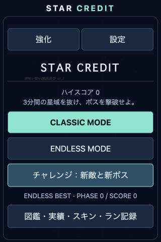
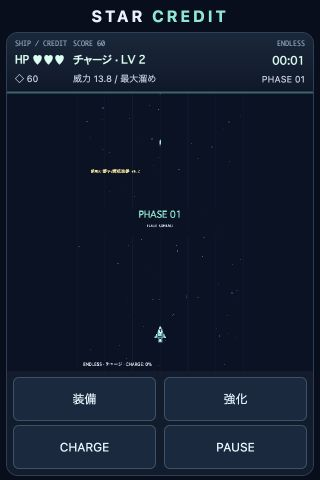
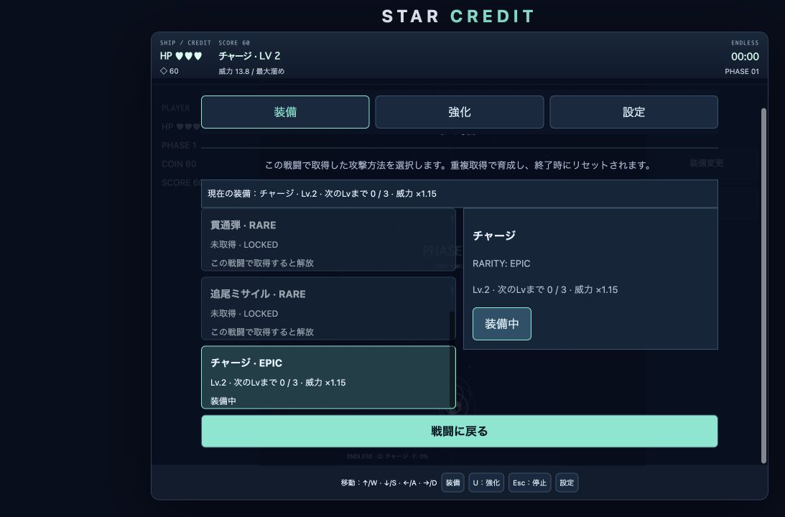

# UI分離・戦闘内装備 実装報告

## 調査と今回の仕様変更

既存構成はJavaScript ES Modules、Canvas 2D、HTML/CSS、server.js、Node標準テストランナー、localStorageで、外部依存なしです。新しいフレームワークは導入していません。

以前は初期3武器、旧v2/v3からの武器所有・育成・装備復元、固定のcoarse判定、共通の下部操作配置でした。今回の指示に合わせ、戦闘内装備を永続データから分離し、基本攻撃パルス弾だけで開始する方式に変更しました。ビームも取得が必要です。成長倍率・必要重複数・レアリティ・攻撃計算・ドロップ率は変更していません。

終了（クリア／ゲームオーバー）、タイトルへの中断、リトライ・別モード開始で、所有・Lv・進捗・選択をパルス弾Lv.1へ戻します。エンドレスの通常フェーズ・ボス撃破による次周期ではリセットしません。クリア時の残アイテム回収と通知を行ってから装備をリセットします。結果画面の獲得通知は履歴として残しますが、次の戦闘へ所有やレベルは持ち越しません。

ゲーム側のinventoryはbattle:trueの単一状態です。カード・HUD・Space/Q・ゲームパッド・PC詳細の装備ボタンが同じ選択処理を使います。旧保存APIは互換検証用に残していますが、実ゲームの戦闘内inventoryは旧武器キーを読み書きしません。旧v2/v3は削除せず保持し、破損・高レベルの旧所有情報も新戦闘へ混入しません。音響、キー設定、スコア、収集進行の保存を維持しています。既存コインと機体/MAGNET強化は従来どおりラン単位です。

## UIと遷移

UIモードはAUTO/MOBILE/DESKTOP、初期値AUTOです。AUTOは幅600px以下、またはcoarse入力かつ幅1024px以下でMOBILE、それ以外でDESKTOP。判定はリサイズ・入力方式変更に追従します。手動指定はstar-credit-ui-v1へ保存し、サイズより優先します。回転では既存の入力解除と一時停止を維持しています。

UI変更ではHP・コイン・機体強化・所有・育成・装備・戦闘時間・ゲームモードを保持します。レイアウト変更時は古い指・キー・溜め入力を解除して誤操作を防ぎます。ブラウザ固有の判定とCSS切替はmain.js、保存と判定はuiMode.js、装備データと選択は既存の共通モジュールに分離しました。

MOBILEではPCキー説明・追加攻撃のキーボード切替ボタン・PC用サイドパネルを非表示にし、装備／強化／CHARGE／PAUSEを2×2で配置します。CHARGEはチャージ装備中だけ表示します。設定はPAUSEとメニュー内のナビゲーションから利用できます。相対ドラッグ、2本指の移動＋溜め、セーフエリア、dvh、スクロール・ジェスチャー抑制を維持しました。MOBILEをPCで強制してもマウスクリックを受け付け、タッチ後の互換クリックだけを抑止します。

DESKTOPでは中央に3:5のCanvas、左右にPLAYER／EQUIPMENTを配置します。760px以下のウィンドウではサイドパネルを下に再配置します。タッチ専用CHARGEを隠し、既存のF、設定済みキー、マウス、ゲームパッドを維持します。装備は一覧と詳細を左右分割し、取得済みカードから詳細を選び「装備する」で反映します。小さいPC画面では縦配置へ変更します。スマホはカードを直接タップして装備します。

タイトルはCLASSIC、ENDLESS、既存チャレンジ、強化、設定、図鑑の入口を保持し、戦闘内装備メニューは表示しません。タイトルの強化は性能・価格の閲覧専用です。購入は戦闘中だけで、永続強化や新しい残高を追加していません。戦闘から装備・強化を開くと停止し、閉じると戦闘に戻ります。PAUSEから開いた場合は元のPAUSEに戻り、明示的に再開します。

## テスト結果

全自動テスト **114件成功、失敗0件、スキップ0件**。既存103件を維持し、今回指定で変わる初期所有・持ち越し・終了後の期待値を更新しました。追加は11件（UI判定・保存・旧装備隔離・端末別装備/入力UI・実ゲームのモード切替・全モードの終了リセット・エンドレス保持など）。

旧版との戦闘比較では、同条件にするため新版にビームLv.1を取得させ、実際のフレームと同じく結果画面で更新を止めています。結果時の装備リセットは今回の仕様差として別テストで検証し、戦闘中の武器・移動・敵・スコア・コイン等は引き続き比較しています。既存のBGM・SE、ドロップ、MAGNET、同時タッチ、キー再設定、パッド、全モード、PWAテストも成功しました。

公開用ビルド成功。PWA manifest・メタタグ・アイコン・BGM資産・依存関係は変更していません。index.htmlはサイドパネルの要素追加のみです。外部公開はしていません。

## ブラウザ検証

メモリ保存の/docs/ui-check.htmlで、敵4体からコイン60、チャージ3個（Lv.2）、ビーム1個を回収して検証しました。PCの一覧→詳細→装備、HUDとサイドパネルの一致、ロック、スマホカード、タイトル復帰後のパルスLv.1、UI選択とAUTOリサイズを確認しました。

- PC 1280×720：左右パネルと中央3:5 Canvasを確認。
- スマホ相当320×480：ドキュメント320×480、主要ボタンは高さ44px、最下端469px。Canvasの下端371px、操作ボタンの上端377pxで重なりなし。PCの移動説明やQ/Fキー表記を非表示にしました。
- AUTOで900×650へ拡大するとDESKTOPへ切替。Canvas282×470で3:5、横スクロールなし。
- コンソールエラー・警告0件。実iPhone/Safariの検証ではありません。

## 変更ファイル

- src/features/uiMode.js（追加）、weaponInventory.js、equipmentUI.js、controlsUI.js
- src/main.js、src/style.css、src/rendering/challenge.js、index.html
- tests/uiMode.test.js（追加）、game.test.js、regression.test.js
- docs/ui-check.html、ui-battle-report.md（追加）、README.md
- docs/screenshots/ui-mobile-title.jpg、ui-mobile-battle.jpg、ui-mobile-equipment.jpg、ui-desktop-battle.jpg、ui-desktop-equipment.jpg（追加）

以前のフェーズ、装備永続化、BGMの報告は実装履歴として保持しています。現在の仕様は本報告とREADMEのUI分離節です。

## 未確認と実機検証手順

実iPhoneのSafari／ホーム画面PWA、ノッチ・ホームインジケータの実セーフエリア、回転時のSafari動作、実機でのスクロール・ズーム抑制、物理ゲームパッド、長時間の難易度・育成バランスは未確認です。

1. 小型iPhoneのSafariとPWAでAUTO起動し、PCキー説明がなく、タイトルのCLASSIC/ENDLESSと設定がタップできることを確認する。
2. 出撃直後にパルスLv.1だけが使用可能で、ビーム・追加攻撃がロックされることを確認する。ドロップを回収し、重複育成・装備切替・MAGNETを確認する。
3. チャージ取得後、移動とCHARGEを別々の指で保持・解放する。装備／強化／PAUSEを開閉し、Canvasとボタンが重ならず、時間停止・再開と入力解除が正しく動くことを確認する。
4. UIモードを手動変更、AUTOで回転・リサイズし、HP・残高・装備・育成・時間が失われないことを確認する。再起動後はUI指定だけ復元し、武器が新戦闘へ持ち越されないことを確認する。
5. エンドレスの通常境界とボス撃破後に装備を維持し、終了・中断・リトライで初期状態へ戻ることを確認する。PCではサイドパネル、一覧＋詳細、変更済みキーと実パッドを試す。
6. BGM選曲・SE・背景移行復帰・全モード・既存記録保存も試す。実利用者の保存データはバックアップした別環境で確認する。
